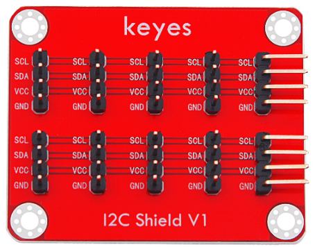
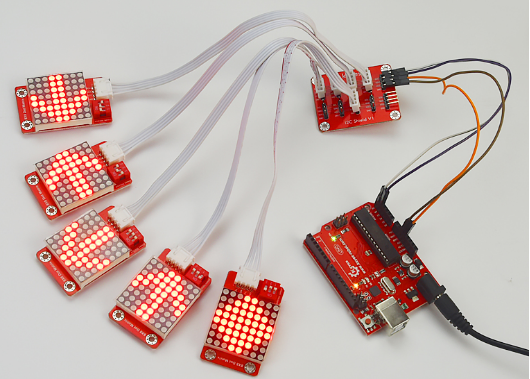

# keyes IIC接口转换扩展板 红色环保

 

 

## **说明**

这是一个I2C接口转换扩展板，可以用于拓展I2C接口（注意：不支持修改I2C地址）。当单片机和其他传感器模块通信时，需要用到I2C通信方式。一般单片机就只是引出一个I2C通信接口，很不方便，有了这个扩展板，就能解决这个麻烦。它将I2C通信端口利用间距为2.54mm的4pin排针引出,共引出10个通信端口，保证单片机可以同时和9个传感器模块进行I2C通信。

## **技术参数**

支持主板：Arduino系列、ESP系列（esp32，esp8266等）、STM系列等

工作电压: DC 5V

通信方式: I2C通信

排针间距：2.54mm

尺寸：50*40 *12mm

重量：9.2g

## **使用方法**

接线图：（请按照实际情况接入）

```
点阵模块---------------------------I2C模块----------------------Arduino UNO主板
SCL                               SCL                                SCL
SDA                               SDA                                SDA
 V                                 V                                 5V/3.3V
GND                               GND                                GND
```

以下是控制 8 个 KE2058 点阵模块的示例代码：

使用Arduino IDE上传下面代码到Arduino UNO主板(其他开发板请参照下面代码修改，不额外提供代码)

[重点：先点此下载导入库文件](./KE0154.7z)

```c
#include <Matrix.h>
Matrix myMatrix1(A4,A5);
Matrix myMatrix2(A4,A5);
Matrix myMatrix3(A4,A5);
Matrix myMatrix4(A4,A5);
uint8_t LedArray1[8]={0x00,0x00,0x18,0x3c,0x7e,0x66,0x00,0x00};
uint8_t LedArray2[8]={0x00,0x18,0x3c,0x7a,0xff,0xff,0x66,0x00};
uint8_t LedArray3[8]={0x00,0x18,0x24,0x42,0x81,0x99,0x66,0x00};
uint8_t LedArray4[8]={0xff,0xe7,0xc3,0x81,0x00,0x00,0x99,0xff};
uint8_t  LEDArray1[8];
uint8_t  LEDArray2[8];
uint8_t  LEDArray3[8];
uint8_t  LEDArray4[8];
void setup(){

myMatrix1.begin(112);     //定义地址0x70的十进制是112
myMatrix2.begin(113);
myMatrix3.begin(114);
myMatrix4.begin(115);
}
void loop(){
        
      for(int i=0; i<8; i++)
  {

    LEDArray1[i]=LedArray1[i];
    for(int j=7; j>=0; j--)
    {
      if((LEDArray1[i]&0x01)>0)
      myMatrix1.drawPixel(j, i,1);
      LEDArray1[i] = LEDArray1[i]>>1;
    }
  }
  myMatrix1.writeDisplay();
  for(int i=0; i<8; i++)
  {
    LEDArray2[i]=LedArray2[i];
    for(int j=7; j>=0; j--)
    {
      if((LEDArray2[i]&0x01)>0)
      myMatrix2.drawPixel(j, i,1);
      LEDArray2[i] = LEDArray2[i]>>1;
    }
  }
  myMatrix2.writeDisplay();
   for(int i=0; i<8; i++)
  {
    LEDArray3[i]=LedArray3[i];
    for(int j=7; j>=0; j--)
    {
      if((LEDArray3[i]&0x01)>0)
      myMatrix3.drawPixel(j, i,1);
      LEDArray3[i] = LEDArray3[i]>>1;
    }
  }
  myMatrix3.writeDisplay();
  for(int i=0; i<8; i++)
  {
    LEDArray4[i]=LedArray4[i];
    for(int j=7; j>=0; j--)
    {
      if((LEDArray4[i]&0x01)>0)
      myMatrix4.drawPixel(j, i,1);
      LEDArray4[i] = LEDArray4[i]>>1;
    }
  }
  myMatrix4.writeDisplay();
}

```

我们利用UNO R3板和扩展板控制8个KE2058 Keyes brick 8X8点阵模块(可选地址)显示不同图案，结果如下图。（这里不同点阵可以显示不图案是因为点阵自身可以更换不同地址，并非I2C模块修改的地址）

 